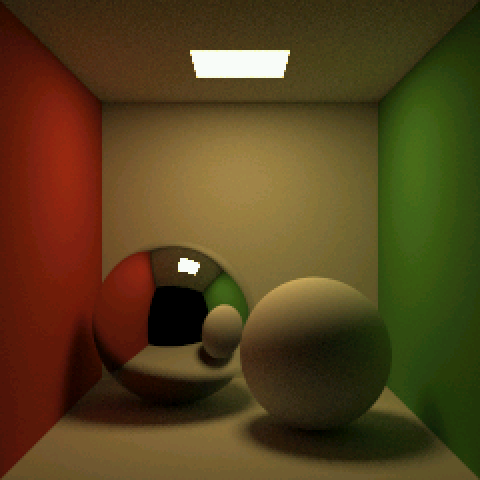
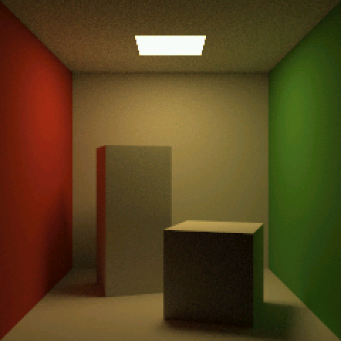
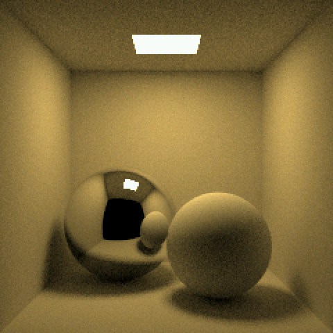
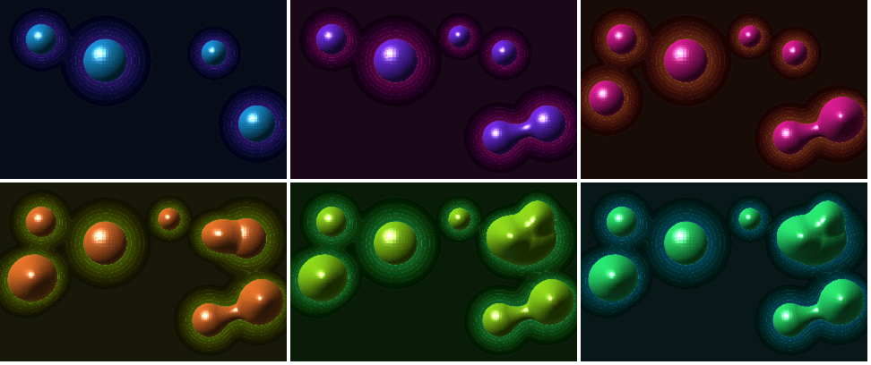
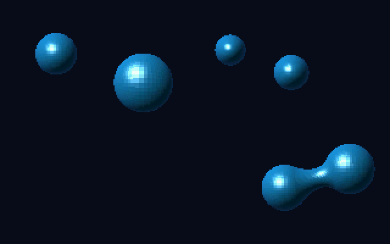
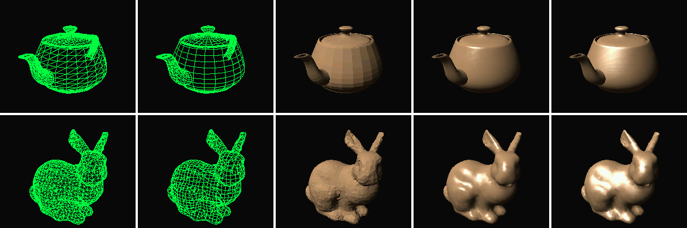
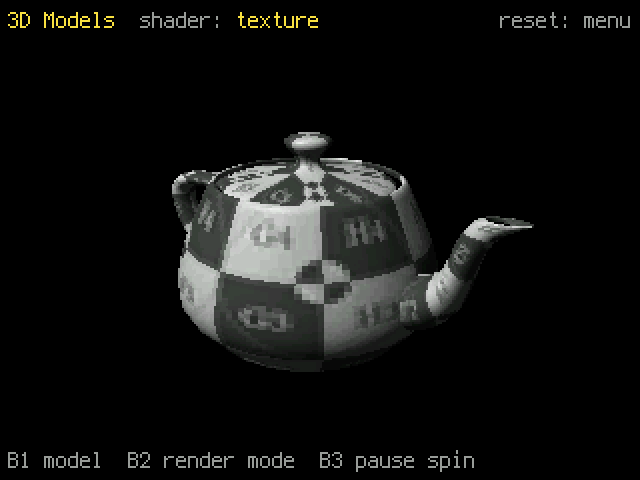

# cg-turbo-demos

Computer graphics demos in the spirit of early SIGGRAPH, running on an
[Adafruit Fruit Jam](https://www.adafruit.com/search?q=fruit+jam) (RP2350) in
CircuitPython, with the hot loops in
[CircuitPython Turbo](https://learn.adafruit.com/circuitpython-turbo): Viper
code compiled ahead of time with `mpy-cross`, plus `asm_thumb` inner loops.
Output is 320x240 RGB565, pixel-doubled to 640x480 HDMI by `picodvi`.


## demos

The board boots into a menu of the demos: button 3 moves up, button 2 down,
button 1 starts the one highlighted. Each demo shows its buttons in the
border around its image. Press reset to come back to the menu.


**VoxelSpace** (`app/voxel_demo.py`): a Comanche-style voxel terrain
fly-over after [s-macke/VoxelSpace](https://github.com/s-macke/VoxelSpace),
on generated terrain, at a locked 30 fps (320x200, letterboxed).

| button | does |
| --- | --- |
| 1 | color map -> height map -> shaded height map |
| 2 | terrain height: full -> 1/2 -> 1/4 -> 1/8 -> flat |
| 3 | fog on / off |


**Cornell box** (`app/cornell_demo.py`): a progressive path tracer, 240x240,
one sample per pixel per pass (0.73 s), refining on screen from noise to a
clean image in a minute or two. The asm kernel uses the RP2350's FPU and is
bit-identical to the numpy reference in `tools/cornell_ref.py`.

| button | does |
| --- | --- |
| 1 | side walls white / back to red and green (starts over) |
| 2 | start over from zero samples |
| 3 | the original's two boxes / back to the two spheres (starts over) |





**Metaballs** (`app/metaballs_demo.py`): six 2D metaballs gliding on
Lissajous paths, shaded as glossy 3D blobs that merge, over a glowing
contoured field. 30 fps at 320x200 with six balls; the asm frame kernel is
bit-identical to the viper reference.

| button | does |
| --- | --- |
| 1 | next hue (six); double-click: glow off / on |
| 2 | one ball fewer (down to 1) |
| 3 | one ball more (up to 10) |





**3D models** (`app/meshes_demo.py`): the Utah teapot (3,926 triangles) and
the Stanford bunny (3,851), spinning slowly and filling the window, at 30 fps
in every mode. The
transform runs on the FPU, then back-face culling, a bucket sort back to front
and an integer scanline fill, all in asm and bit-identical to the references.
Phong and Blinn light every pixel from its interpolated normal. The teapot is
a cool glazed clay and the bunny light gray (`tools/make_mesh_luts.py`).
The teapot also wears a 512x512 texture: a UV test grid on an injective
layout (body around the bottom half; lid, handle and spout in the top half),
each part tinted as in the Utah teapot page's layout figure, Phong lit, with
texture coordinates and normals interpolated per pixel.

| button | does |
| --- | --- |
| 1 | teapot / bunny |
| 2 | quad wireframe (white, the start) -> triangle wireframe (green) -> Lambert (flat) -> Phong -> Blinn -> texture (teapot only) |
| 3 | pause / resume the spin |




The teapot is Martin Newell's 1975 Bezier patch data (via three.js); the
bunny is from the
[Stanford 3D Scanning Repository](https://graphics.stanford.edu/data/3Dscanrep/).
`tools/make_meshes.py` downloads both and rebuilds `assets/teapot.bin` and
`assets/bunny.bin`. The texture is the UV test grid from the University of
Utah's [teapot page](https://graphics.cs.utah.edu/teapot/), whose injective
layout this one follows; `tools/make_teapot_texture.py grid.png` rebuilds
`assets/teapot_texture.bin` from it.

To skip the menu while developing, set `DEMO` in `app/code.py` to a demo's
module (`"voxel_demo"`, `"cornell_demo"`, `"metaballs_demo"` or
`"meshes_demo"`). The menu's thumbnails come from
`python3 tools/make_menu_thumbs.py`.

Coming: USB gamepad flying, and more Cornell box scenes. See
[NOTES.md](NOTES.md) for the plan, every measurement, and what was learned
about making Turbo code fast on this board.

## hardware and firmware

- Adafruit Fruit Jam and an HDMI display.
- Stock CircuitPython 10.3.1 or later (Turbo `.mpy` loading is built in on
  RP2xxx). Developed on `11.0.0-alpha.1-126-gea91926f34`.
- Adafruit's `mpy-cross` for the **same** firmware version, saved as
  `tools/mpy-cross`: builds are at
  `https://adafruit-circuit-python.s3.amazonaws.com/bin/mpy-cross/macos/mpy-cross-macos-<version>-arm64`
  (other platforms in the neighboring folders). Check `boot_out.txt` for the
  version.

## build and run

```sh
python3 tools/build.py --deploy        # compile src/ to lib/*.mpy, copy lib, app and assets to CIRCUITPY
python3 tools/serial_log.py --restart  # restart code.py and watch the console (frame times)
```

The first deploy saves the board's existing `code.py` to `backup/`.
`app/code.py` picks the demo (`voxel_demo`, or `fb_bench` for the
framebuffer benchmark).

## layout

- `app/`: plain Python that runs from source on the board (demo setup,
  camera, buttons).
- `src/`: Turbo modules, compiled to `.mpy` (`voxel.py` reference kernel and
  frame driver, `voxel_asm.py` generated asm).
- `tools/`: build and deploy, terrain generator (`make_terrain.py`, needs
  NumPy and Pillow), asm generator (`gen_voxel_asm.py`), desktop renderer and
  flicker meter (`voxel_host.py`, `voxel_flicker.py`), board runner.
- `tools/asm_to_viper.py` is from Adafruit's
  [Motion Tracking Eyeballs](https://github.com/adafruit/Adafruit_Learning_System_Guides/tree/main/CircuitPython_Turbo/Motion_Tracking_Eyeballs)
  guide (MIT, Liz Clark): it lets stock firmware load `asm_thumb` code.

The desktop renderer runs the same Viper reference kernel as the board (with
stand-in decorators in `tools/host/`), and board frames from the asm kernel
are checked bit-for-bit against it.

## credits

Code:

- `tools/asm_to_viper.py` is from Adafruit's
  [Motion Tracking Eyeballs](https://github.com/adafruit/Adafruit_Learning_System_Guides/tree/main/CircuitPython_Turbo/Motion_Tracking_Eyeballs)
  guide by [Liz Clark](https://github.com/BlitzCityDIY) (MIT).
- The Utah teapot's Bezier patch data comes from [three.js](https://threejs.org/)'s
  [TeapotGeometry.js](https://github.com/mrdoob/three.js/blob/r160/examples/jsm/geometries/TeapotGeometry.js)
  (MIT), downloaded by `tools/make_meshes.py`.

Data and images:

- [Utah teapot](https://en.wikipedia.org/wiki/Utah_teapot):
  [Martin Newell](https://en.wikipedia.org/wiki/Martin_Newell_(computer_scientist))'s
  1975 patches. The texture is the UV test grid from the University of
  Utah's [teapot page](https://graphics.cs.utah.edu/teapot/) by
  [Cem Yuksel](https://www.cemyuksel.com/), and the injective layout and its
  part colors follow that page.
- [Stanford bunny](https://en.wikipedia.org/wiki/Stanford_bunny): the
  [Stanford 3D Scanning Repository](https://graphics.stanford.edu/data/3Dscanrep/),
  downloaded by `tools/make_meshes.py`.
- The VoxelSpace terrain is generated by `tools/make_terrain.py`; the
  Cornell box scene is modeled in `tools/cornell_scene.py`.

Research and reference:

- [s-macke/VoxelSpace](https://github.com/s-macke/VoxelSpace) by
  [Sebastian Macke](https://github.com/s-macke): the voxel terrain algorithm
  of NovaLogic's [Comanche](https://en.wikipedia.org/wiki/Comanche_(video_game_series))
  (1992), explained.
- The [Cornell box](https://en.wikipedia.org/wiki/Cornell_box), from Cornell
  University's Program of Computer Graphics: the scene and reference image
  the path tracer was compared against. Goral, Torrance, Greenberg and
  Battaile, ["Modeling the interaction of light between diffuse surfaces"](https://doi.org/10.1145/964965.808601)
  (SIGGRAPH 1984).
- Adafruit's [CircuitPython Turbo](https://learn.adafruit.com/circuitpython-turbo)
  guide, the
  [Pixeldust](https://learn.adafruit.com/pixeldust-digital-sand-for-circuitpython/code-metro-rp2350)
  guide, and [Mikey Sklar](https://github.com/mikeysklar)'s
  [turbo](https://github.com/mikeysklar/turbo) examples: how Turbo code is
  built, loaded and made fast.
- [MicroPython](https://micropython.org/)'s
  [viper code emitter](https://docs.micropython.org/en/latest/reference/speed_python.html#the-viper-code-emitter)
  docs.
- Adafruit's [Crankfruit](https://github.com/adafruit/crankfruit) (the
  Impossible-Playdate project) for the Fruit Jam's DVI output and gamepad
  input.
- The graphics papers behind the demos:
  - [Bui Tuong Phong](https://en.wikipedia.org/wiki/Bui_Tuong_Phong),
    ["Illumination for computer generated pictures"](https://doi.org/10.1145/360825.360839)
    (Communications of the ACM, 1975): Phong shading.
  - [Jim Blinn](https://www.jimblinn.com/),
    ["Models of light reflection for computer synthesized pictures"](https://doi.org/10.1145/563858.563893)
    (SIGGRAPH 1977): Blinn shading; and
    ["A generalization of algebraic surface drawing"](https://doi.org/10.1145/357306.357310)
    (ACM Transactions on Graphics, 1982): the blobby objects behind metaballs.
  - [Jim Kajiya](https://en.wikipedia.org/wiki/James_Kajiya),
    ["The rendering equation"](https://doi.org/10.1145/15922.15902)
    (SIGGRAPH 1986): path tracing.

Built with [CircuitPython](https://circuitpython.org/),
[mpy-cross](https://github.com/adafruit/circuitpython/tree/main/mpy-cross) and
[picodvi](https://docs.circuitpython.org/en/latest/shared-bindings/picodvi/),
and on the desktop [NumPy](https://numpy.org/) and
[Pillow](https://python-pillow.org/). The boot menu uses Adafruit's
[adafruit_display_text](https://github.com/adafruit/Adafruit_CircuitPython_Display_Text)
library.

## license

MIT: see [LICENSE](LICENSE). `tools/asm_to_viper.py` keeps its own MIT
notice (Liz Clark for Adafruit Industries).
